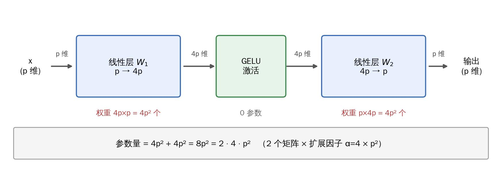
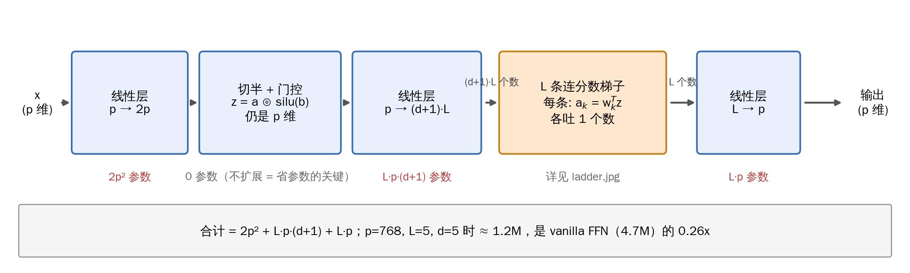
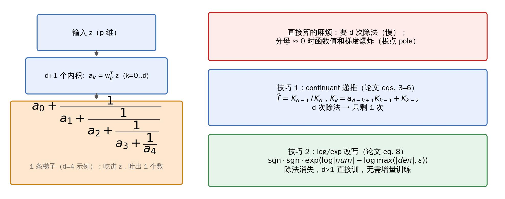

# CoFrGeNet-FNG（非官方 PyTorch 实现）

[English](README.md) | 简体中文

IBM Research 论文 [Non-Expanding Gated Continued Fraction Architecture for
Feedforward Layers in Language Models](https://arxiv.org/abs/2611.26835)
（NeurIPS 2026）中 **CoFrGeNet-FNG** —— *Non-Expanding Gated Continued
Fraction* 前馈层 —— 的非官方 PyTorch 实现，附带经典 FFN 基线和一个用于
连分数梯子的 Triton 融合 kernel。

> **说明：** 本仓库是独立按论文复现的实现。作者官方仓库
> [IBM/CoFrNets](https://github.com/IBM/CoFrNets) 在本文撰写时尚未放出代码。

## CoFrGeNet-FNG 是什么？

它是 transformer（以及 SSM / MoE）block 中 FFN 子层的**直接替代品**
（drop-in replacement），API 同样是 `(…, p) -> (…, p)`，但参数量约为
原来的 1/4：

1. **非扩展门控投影**：`x ∈ R^p → z ∈ R^p`（扩展因子 α = 1），计算方式为
   `z = a ⊙ silu(b)`，其中 `[a, b]` 是一次线性映射后切两半得到的
   —— 共 2p² 个参数。
2. **L 条深度为 d 的连分数"梯子"**：每条梯子有 d+1 个可学习的系数向量，
   a_k = w_kᵀz，计算有理函数

   ```
   f~(a_1..a_d) = 1/(a_1 + 1/(a_2 + ... + 1/a_d))
   ```

   通过 continuant（连分式多项式）递推（论文 eqs. 3–6）求值，每条梯子
   只需 **1 次**除法而不是 d 次。
3. **log/exp 除法**（论文 eq. 8）：把剩下的这次除法改写成
   `sgn·sgn·exp(log|num| − log max(|den|, ε))`，使得深层梯子（d > 1）
   的训练保持稳定，**无需**原版 CoFrGeNet 所要求的增量训练（incremental
   training）流程。
4. 一个线性投影 `R^L → R^p`。

参数量：`2p² + L·p·(d+1) + L·p`，而 vanilla FFN 为 `2αp²`，SwiGLU 为
`3αp²`（α ≥ 2）。

## 通俗版：这四步到底在干嘛

**先算 FFN 的账**（为啥是 2·4·p²）：FFN 就两个矩阵——W₁ 把 x 从 p 维
升到 4p 维（权重 4p×p = 4p² 个），激活函数没有参数，W₂ 再降回 p 维
（又是 4p² 个）。合计 8p²，也就是"**2 个矩阵 × 扩展因子 4 × p²**"：



FNG 用四步替代这条路，核心思想是：**FFN 靠"升维摊开 + 激活函数"获得
表达力，FNG 靠"门控筛选 + 一组有理函数"获得表达力**，后者每个参数的
表达效率更高，所以不升维、用约 1/4 参数就能接近同等效果。

1. **门控投影（不升维，先筛一遍）**：线性层把 x 映到 2p 维切成两半，
   `z = a ⊙ silu(b)`——silu(b) 像逐维度的"水龙头"，决定 a 的哪些维度
   放行。z 仍是 p 维，"非扩展"是省参数的关键。
2. **连分数梯子（核心非线性）**：每条梯子自带 d+1 个权重向量，
   a_k = w_kᵀz，把 p 维的 z 压成 1 个数；L 条梯子并行吐出 L 个数。
   数学上连分数是实数的**最优有理逼近**，用极少参数就能表达复杂函数。
3. **log/exp 除法（工程技巧）**：直接算连分数要 d 次除法且分母可能为
   0（极点，梯度爆炸）。continuant 递推先把 d 次除法变 1 次，再把这
   1 次改写成 `exp(log|num| − log|den|)`——除法变减法，训练就稳了，
   不再需要原版 CoFrGeNet 的增量训练流程。
4. **投影回 p 维**：L 个数过线性层回到 p 维，接回残差流。



梯子内部和两个稳定性技巧的细节：



> 进一步："FNG 表达力更强"能不能不靠实验、从数学上证明？能证明什么、
> 证明不了什么，见 [docs/theory.md](docs/theory.md)（命题 + 证明思路 +
> 参考文献）。

## 安装

```bash
# 从 PyPI 安装
pip install cofrgenet-torch             # 唯一硬依赖是 torch
pip install "cofrgenet-torch[triton]"   # 可选：融合 Triton 前向/反向（GPU）

# 或从源码安装（本仓库）
pip install -e .
```

可选：融合 Triton 梯子 kernel（CPU 后端）：

```bash
# GPU
pip install triton
# CPU（实验性 triton-cpu 后端，按你的平台和 Python 版本选择）
pip install "https://github.com/triton-lang/triton-cpu/releases/download/v3.8.0/triton-3.8.0%2Bcpu-cp312-abi3-manylinux_2_27_x86_64.manylinux_2_28_x86_64.whl"
```

注意：triton-cpu 的 wheel 要**最后**安装。torch 会固定（pin）自己的
triton 版本，之后再执行任何触及 torch 依赖的 `pip install`，都可能把
`+cpu` wheel 替换回 mainline triton（没有 CPU 后端）。

## 快速上手

```python
import torch
from cofrgenet_fng import CoFrGeNetFNG

ffn = CoFrGeNetFNG(p=768, n_ladders=5, depth=5)   # 与 FFN 相同的 API
x = torch.randn(2, 128, 768)
y = ffn(x)                                        # (2, 128, 768)

sum(t.numel() for t in ffn.parameters())          # 1,208,862（vanilla FFN 为 4.7M）
```

## 示例

在仓库根目录下运行。

### `fng_vs_ffn.py` —— FNG 对比 FFN 基线

先验证 continuant 数学正确性，再对比参数量、速度和师生（teacher-student）
拟合能力。在 8 核 CPU（torch 2.9.1）上实测：

```
module                             params   vs FFN    fwd+bwd
VanillaFFN (alpha=4)            4,722,432    1.00x   259.90 ms
SwiGLUFFN (alpha=8/3)           4,723,456    1.00x   234.54 ms
CoFrGeNetFNG (L=5, d=5)         1,208,862    0.26x    69.60 ms
CoFrGeNetFNG (L=8, d=8)         1,243,464    0.26x    74.09 ms
```

在这个玩具拟合任务上，FNG 用 1/3 的参数量但收敛比全尺寸 FFN 慢——这与
论文一致：论文中持平或更优的结果是语言模型预训练规模下的结论，而不是
小型回归任务。

### `fng_triton.py` —— Triton 融合梯子 kernel

梯子在 eager PyTorch 里是一串串行的小 elementwise 算子；kernel 把**前向和
反向**都融合成了 pointwise 遍历（前向：continuant 递推 + 一次 log/exp
除法；反向：手写解析 adjoint，同样无除法，通过 `ladder_apply` /
`CoFrGeNetFNGTriton` 接入 autograd）。triton-cpu 后端前向实测（共享 CPU
上数字逐次运行有波动；稳定的是梯子级别的加速——在整 block 层面，p→2p
的 GEMM 占主导，差异在噪声范围内）：

```
(B=16, S=256, L=8, d=8)  N=32,768 条梯子:      eager 0.679 ms | triton 0.164 ms (4.13x)
(B=64, S=1024, L=16, d=8) N=1,048,576 条梯子:  eager 16.262 ms | triton 5.945 ms (2.74x)
```

运行方式：`TRITON_DEFAULT_BACKEND=cpu python fng_triton.py`（GPU 上直接
`python fng_triton.py`）。

### GPU 实测（NVIDIA H20，前向+反向）

Triton kernel 支持 `float32` / `bfloat16` / `float16` 原生存储，内部用
fp32 累加以保证极点附近的数值稳定。单张 H20 上单个 FFN 模块前向+反向
实测（`p=768, B=8, S=4096, L=5, d=5`）：

```
precision         FFN   FNG-eager  FNG-triton  speedup
fp32          26.49 ms     7.20 ms      6.98 ms    3.79x
fp32+tf32     12.42 ms     4.32 ms      4.11 ms    3.02x
bf16           6.59 ms     2.76 ms      2.56 ms    2.58x
fp16           6.55 ms     2.91 ms      2.60 ms    2.52x
```

bf16 下扩大模型（`L=8, d=5`）：`p=2048` 时加速 **3.68x**；`p=4096` 时
（**81.28 ms → 18.67 ms，4.35x**）仍保持 4 倍以上加速。FNG 内部耗时
90% 以上来自 cuBLAS 的 `p → 2p` 门控 GEMM，梯子本身只需 ~20 µs。

### `mnist_train.py` —— MNIST 前向+反向训练测试

在 CPU 上端到端训练同一个残差小分类器（8 epoch，batch 256，AdamW
lr=5e-4，梯度裁剪 1.0），只替换其中的 FFN 模块。数据直接从 MNIST 官方
IDX 镜像下载解析，不依赖 torchvision。

```
block        params    test_acc @8   step
ffn          233,738     97.66%     5.0 ms
fng-eager    149,610     93.76%     5.9 ms
fng-triton   149,610     93.23%     5.1 ms
```

`fng-triton` 梯子的前向和反向均走融合 Triton kernel，训练曲线和
`fng-eager` 高度一致（仅存在浮点舍入漂移）。在 `depth=5, L=16` 下 FNG
只用 0.64x 参数量达到 ~93–94% 测试准确率；`depth=8` 在这个小规模下明显
更难优化。

运行方式：`TRITON_DEFAULT_BACKEND=cpu python mnist_train.py`。

## 测试

```bash
pip install pytest
pytest -v          # 未安装 triton 时相关测试自动跳过
```

## 仓库结构

```
cofrgenet_fng/        包本体
  layers.py           VanillaFFN、SwiGLUFFN、CoFrGeNetFNG、continuant_fraction
  triton_ladder.py    融合 Triton 前向/反向 kernel（可选）、CoFrGeNetFNGTriton
fng_vs_ffn.py         示例：FNG 对比 FFN 基线
fng_triton.py         示例：Triton kernel 正确性 + 基准测试
mnist_train.py        示例：MNIST 前向+反向训练测试
tests/                pytest 测试套件
docs/                 README 配图（make_figures.py 可重新生成）+ theory.md 理论分析
```

## 引用

```bibtex
@article{dhurandhar2026cofrgenetfng,
  title   = {Non-Expanding Gated Continued Fraction Architecture for Feedforward Layers in Language Models},
  author  = {Dhurandhar, Amit and Chenthamarakshan, Vijil and Ramamurthy, Karthikeyan Natesan and Wei, Dennis and Nair, Rahul},
  journal = {arXiv:2611.26835},
  year    = {2026}
}

@inproceedings{dhurandhar2026cofrgenet,
  title     = {CoFrGeNet: Continued Fraction Architectures for Language Generation},
  author    = {Dhurandhar, A. and Chenthamarakshan, V. and Wei, D. and Pedapati, T. and Ramamurthy, K. N. and Nair, R.},
  booktitle = {Proceedings of the 43rd International Conference on Machine Learning (ICML)},
  year      = {2026}
}
```

## 许可证

MIT —— 见 [LICENSE](LICENSE)。
