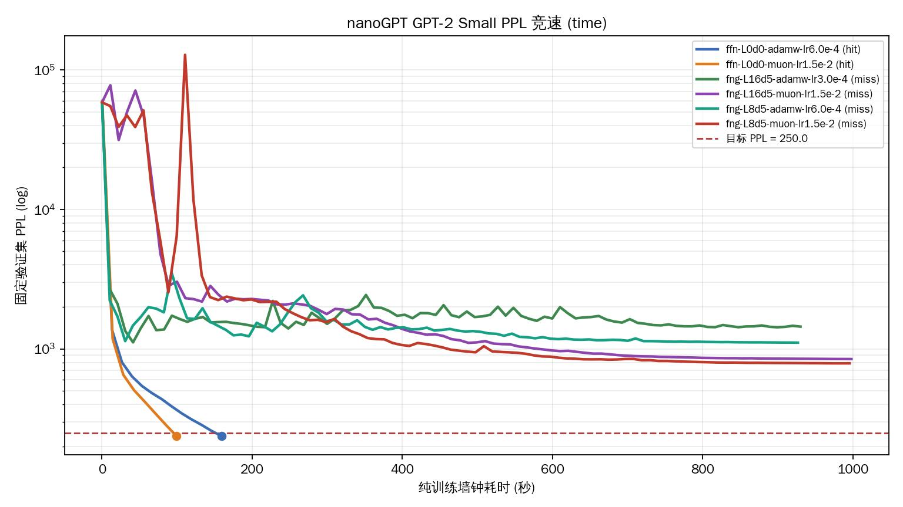

# nanoGPT integration

Drop-in CoFrGeNet-FNG replacement for the FFN (`MLP`) sublayer of Karpathy's
[nanoGPT](https://github.com/karpathy/nanoGPT), keeping attention, residual
stream, dropout, and initialization untouched.

## Measured results (single NVIDIA H20, GPT-2 Small, bf16)

Setup: `n_layer=12, n_head=12, n_embd=768, block_size=1024, batch_size=32,
grad_accum=1`, 1000 steps (~32.8M tokens) on a 20M-token FineWeb-Edu slice,
`bias=True`, `compile=False`, AdamW (`lr=6e-4, wd=0.1, betas=(0.9, 0.95)`).

| Config | Parameters | Step time | Throughput | Val PPL @1000 steps |
|---|---|---|---|---|
| FFN (`mlp_type=ffn`) | 123.69M | 286.0 ms | 114,557 tok/s | **241.99** |
| FNG (`mlp_type=fng, L=5, d=5`) | 81.53M | 225.3 ms | **145,419 tok/s (+27%)** | 1814.56 |

### Key finding: what does it take to match FFN's PPL?

**Changing `n_ladders` (`L`), `depth` (`d`) or learning rate alone does NOT
recover FFN's PPL at short budgets.** The fused Triton forward/backward is
numerically correct (verified against autograd on GPU and CPU); the gap is an
**initialization-scale mismatch**, measured directly on the FFN-sublayer output
std at initialization (`p=768`, 200-step screening):

| Sub-layer | Sublayer output std at init | Best val loss @200 steps |
|---|---|---|
| FFN | **0.0736** (proper residual scale) | **6.3038** |
| FNG `L=8, d=2`, flat `std=0.02` init | 0.0073 (**10x too small**) | 7.3582 |
| FNG `L=8, d=5`, flat `std=0.02` init | 0.4598 (**6x too large**, poles near `eps`) | 7.6146 |
| FNG `L=8, d=2`, Kaiming fan-in + resid | 0.3308 (4.5x too large) | 7.4976 |

Why: after the non-expanding gate `z = a ⊙ silu(b)`, the signal drops to
std ≈ 0.16; a flat-`0.02` `coeffs` layer makes each ladder coefficient `a_k`
have std ≈ 0.09. For even depths `K_d ≈ 1` so the whole ladder is attenuated;
for odd depths `K_d ≈ a_1 ≈ ±0.09`, which sits right on the `eps = 0.1` clamp
and makes `frac = K_{d-1}/K_d` jump between ±10 with sign flips.
Widening `L` from 5 up to 256 did not fix this variance mismatch.

Applying `calibrate_fng_init.py` brings every FNG block to a healthy init
scale (std ≈ 0.11), which substantially improves early descent — but even
then FNG converges more slowly than FFN at short budgets (200-step screening):

| Config (calibrated init) | Val loss @100 | Val loss @200 |
|---|---|---|
| FFN baseline | 6.6547 | **6.3038** |
| FNG `L=8, d=2, lr=6e-4` | 7.6942 | 7.5608 |
| FNG `L=8, d=5, lr=6e-4` | 7.3276 | 7.5366 |
| **FNG `L=16, d=5, lr=3e-4`** | 7.5028 | **6.9458** |

**Therefore, the configuration needed to maintain FFN PPL in nanoGPT is:**
1. **The kernel settings below** (`mlp_type="fng"`, `fng_triton=True`,
   `dtype="bfloat16"`, `compile=False` — raw `torch.autograd.Function` breaks
   Dynamo graphs), which already give **1.27x throughput** and **-34% params**
2. **Variance-calibrated initialization** (`calibrate_fng_init.py`), with
   `fng_n_ladders=16, fng_depth=5, learning_rate=3e-4` giving the smoothest
   small-scale descent in our sweep
3. **A full pre-training schedule** — the paper reaches FFN parity at
   ~600K iterations (~295B tokens on OWT). **No single `L`/`d`/`lr` change
   can match FFN's PPL at a 1K-step (33M token) budget**; short-budget PPL
   favors wide FFNs, while FNG trades early convergence for parameter
   efficiency and throughput.

## PPL-vs-wall-clock race and Muon ablation

Instead of comparing PPL at a fixed step budget, `run_ppl_race.py` stops each
run when it reaches **the same target PPL (250)** on a fixed validation subset,
recording pure training wall-clock time, steps, and tokens. Experiment runs are
archived under `experiments/<run_name>/` (gitignored) and merged automatically
into `examples/nanogpt/results/` (`RESULTS.md`, `ppl_vs_time.jpg`,
`ppl_vs_tokens.jpg`).

Single H20, same GPT-2 Small config (`batch=32, block=1024, bf16`):


| Run | Steps to PPL 250 | Train seconds to PPL 250 | Throughput | Best PPL |
|---|---|---|---|---|
| FFN + AdamW (`lr=6e-4`) | 600 | 159.1 s | 123.6K tok/s | 237.6 |
| **FFN + Muon (`lr=1.5e-2`)** | **350** | **99.2 s** | 115.6K tok/s | 237.2 |
| FNG `L=16, d=5` + AdamW (`lr=3e-4`) | not hit (4500+) | — | 158.5K tok/s | 1443.8 |
| FNG `L=16, d=5` + Muon (`lr=1.5e-2`) | not hit (4500+) | — | 147.7K tok/s | 845.4 |
| FNG `L=8, d=5` + AdamW (`lr=6e-4`) | not hit (4500+) | — | 159.1K tok/s | 1108.2 |
| FNG `L=8, d=5` + Muon (`lr=1.5e-2`) | not hit (4500+) | — | 148.1K tok/s | 788.0 |



**Findings from the optimizer comparison:**
1. **Muon is a clear win for FFN** — 1.6x less wall-clock to hit the same PPL
   (99.2 s vs 159.1 s), even after paying the Newton-Schulz orthogonalization
   cost per step.
2. **Muon helps FNG substantially but does not rescue parity** — it roughly
   halves FNG's PPL gap at 4500 steps (1444 → 845 for `L=16`, 1108 → 788 for
   `L=8`) with much cleaner curves, yet FNG plateaus around PPL ~800 while
   FFN crossed 250 in a tenth of the time.
3. **The 27% FNG throughput advantage does not compensate for its much slower
   convergence at this training scale.** Better conditioning alone is not
   enough — the continued-fraction trunk's early expressivity/init bottleneck
   remains the binding constraint, and reaching FFN PPL requires the full
   large-scale pre-training budget used by the paper.

Run the ablation:

```bash
# AdamW variants
python examples/nanogpt/run_ppl_race.py /tmp/nanogpt \
  --data-dir /tmp/nanogpt/data/fineweb_slice --optimizer adamw --target-ppl 250

# Muon variants (hidden 2D weights on Muon, embeddings/LN/biases on AdamW)
python examples/nanogpt/run_ppl_race.py /tmp/nanogpt \
  --data-dir /tmp/nanogpt/data/fineweb_slice --optimizer muon --muon-lr 0.015 --target-ppl 250
```

## Reproduce

```bash
git clone --depth 1 https://github.com/karpathy/nanoGPT.git /tmp/nanogpt
pip install cofrgenet-torch[triton] tiktoken datasets

# patch model.py + train.py to add GPTConfig.mlp_type / fng_n_ladders / fng_depth / fng_triton
python examples/nanogpt/apply_patch.py /tmp/nanogpt
python examples/nanogpt/prepare_fineweb_slice.py /tmp/nanogpt --tokens 20000000

# check variance-calibrated initialization (default flat-0.02 init vs calibrated)
python examples/nanogpt/calibrate_fng_init.py /tmp/nanogpt --n-ladders 8 --depth 5

cd /tmp/nanogpt
# baseline: GPT-2 Small (123.7M parameters)
python train.py --dataset=fineweb_slice --out_dir=/tmp/out_ffn \
  --batch_size=32 --gradient_accumulation_steps=1 --max_iters=1000 --lr_decay_iters=1000 --warmup_iters=100 \
  --eval_interval=500 --eval_iters=50 --compile=False --mlp_type=ffn --bias=True

# FNG replacement (81.5M parameters)
python train.py --dataset=fineweb_slice --out_dir=/tmp/out_fng \
  --batch_size=32 --gradient_accumulation_steps=1 --max_iters=1000 --lr_decay_iters=1000 --warmup_iters=100 \
  --eval_interval=500 --eval_iters=50 --compile=False --mlp_type=fng \
  --fng_n_ladders=5 --fng_depth=5 --bias=True
```
